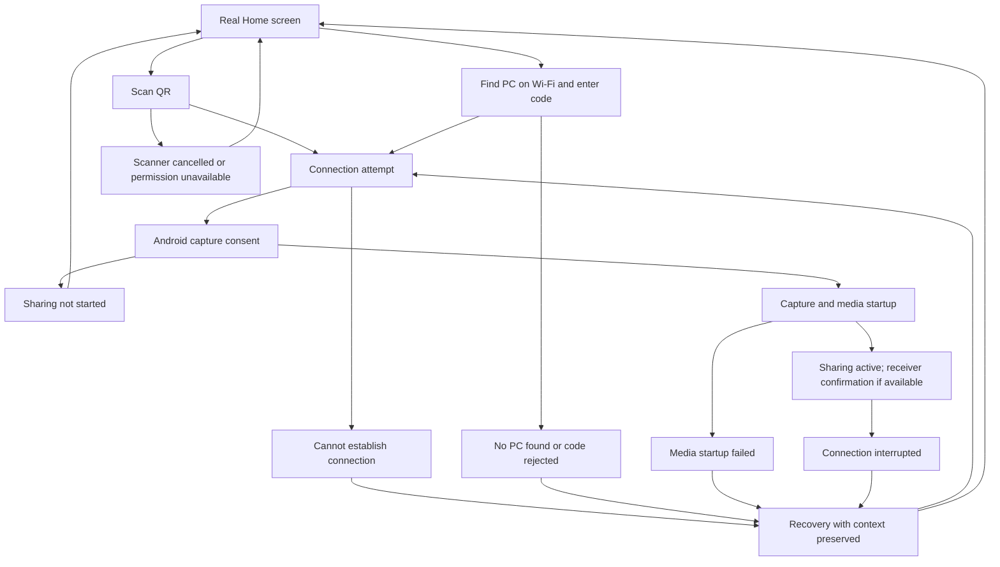

# Real journey, including failure

Status: proposed interaction model. Recovery actions below require support from the real app; this document does not claim they are implemented.

## Guide real actions

| Moment | Guidance and advancement condition |
| --- | --- |
| Phone Home | Reveal Scan QR. Suggested hint: “Open GoCast on your PC, then scan its QR code.” Keep Find on Wi-Fi available without forcing people through both methods. |
| PC pairing screen | Keep the actual QR prominent, with code and PC identity clearly related. A displayed QR is not proof that the receiver can accept a connection. Any readiness wording must use real receiver status. |
| QR selected | Suspend the overlay before the scanner or camera permission opens. Cancellation returns to a usable screen; a successful scan means only that an address was read. |
| Wi-Fi selected | Search for PCs, then reveal the selected PC's real code field. Suggested hint: “Enter the code shown on this PC.” No invented sample host or code. |
| Connecting | Show actual status with a way to leave or cancel. Tutorial progression waits for the application's outcome. |
| Capture consent | Let Android present its own sheet. Cancellation means “Screen sharing hasn't started”, with an intentional way to try again. Never reopen consent automatically in a loop. |
| Sharing starts | Reveal the actual Stop control briefly. Do not claim the picture is visible on the PC solely because local capture started. |
| Quality opened | Introduce the real presets. Explain profile saving when the user reaches the save control. No settings changes made solely to advance education. |

Android requires consent for each new media-projection session. A saved tutorial checkpoint cannot restore permission or reuse a consumed capture token. [Android media projection](https://developer.android.com/media/grow/media-projection).

## Branches

This diagram is a user journey, not a required transport ordering. Map it to actual pairing, signalling, consent, and media events during implementation.

## Recovery is part of the main journey

On failure, remove the educational overlay and show a stable recovery surface in context. Say what is known, preserve relevant input and selection while valid, and offer an action that can change the outcome. Additional diagnostic detail belongs behind a disclosure. Avoid a toast as the only way to understand a blocking failure.

| Situation | Message direction | Recovery and checkpoint |
| --- | --- | --- |
| Camera unavailable or denied | Explain why scanning cannot open. | Retry permission only when appropriate; offer Settings after permanent denial and Wi-Fi/code as a camera-free route. Keep guidance at connection choice. |
| Scanner cancelled | Treat as an intentional return. | Leave both methods available. Do not label cancellation as failure or automatically reopen scanning. |
| QR not recognised | “This isn't a GoCast QR code.” | Allow another scan; do not start connecting. |
| No PCs found | “No PCs found yet.” | Provide another search and relevant checks. QR can supply an address but does not bypass a broken network path. |
| Code rejected or session explicitly expired | Explain the specific server response. | Let the person edit the code or obtain the current QR/code from the PC. Never infer expiry from every connection error. |
| PC cannot be reached | “Couldn't reach this PC.” | Retry the same target, choose a different target, or inspect connection details. Explain that both methods still need a reachable PC. Do not assert a firewall or Wi-Fi cause without evidence. |
| Connection accepted, capture cancelled | “Screen sharing hasn't started.” | Offer an intentional retry from the actual current state. Revalidate the link if initial consent cancellation closed it. |
| Link established, media startup fails | Explain that connecting and displaying the screen are different outcomes. | Recover media startup or reconnect as supported. Never advance to a congratulatory casting step. |
| Active connection drops | Explain the interruption and actual retry status. | Stop success/feature hints. Keep Stop/Cancel available; restore guidance only after genuine recovery. |
| Unknown failure | Describe the failed operation without inventing its cause. | Show the supported retry/change-target actions and optional diagnostic details. Preserve the checkpoint. |

Automatic retries must have a defined limit and a visible route out. The appropriate timeout/retry budget needs a separate review of existing transport behaviour; an overlay timer must not control it. Switching methods does not itself fix connectivity. These proposals apply Android's recovery guidance and GOV.UK's distinction between input and service problems. [Android onboarding](https://developer.android.com/design/ui/mobile/guides/patterns/onboarding), [GOV.UK error messages](https://design-system.service.gov.uk/components/error-message/).

## Progress and precedence

Keep three facts separate: hints seen/dismissed, task milestones achieved, and the live session state. Skipping help does not mark a cast successful. A failure does not erase completed learning. Restarting the app never restores a stale “connected” or consent state from tutorial storage.

System dialogs and failures take priority over educational hints. User cancellation takes priority over pending results. Associate asynchronous outcomes with the current attempt so a late success or error from an abandoned attempt cannot resurrect a hint or overwrite the next attempt.

Resume only when a step's real target exists and its prerequisites hold. Replaying How it works reopens relevant guidance; it must not reconnect, reset settings, or start capture by itself. If the user explores settings before connecting, allow it and introduce the relevant controls there.

## Current code observations

Read-only source inspection on 25 October 2026; these are narrower than a full networking audit:

- `android/app/src/main/java/app/gocast/domain/ConnectionState.kt` exposes Idle, Connecting, Connected, Reconnecting, and Failed with a string reason. A typed recovery classification is not supplied by this model.
- `android/app/src/main/java/app/gocast/capture/CaptureService.kt` separately exposes Idle, Casting, and Paused. Local Casting is derived from local media activity; this field alone does not confirm a rendered frame on the PC. Whether another receiver-confirmation event exists remains unverified.
- `android/app/src/main/java/app/gocast/cast/CastViewModel.kt` rejects new joins while Connecting, Connected, or Reconnecting. Retry/change-method designs must account for terminating or replacing an existing attempt; a tutorial button cannot bypass that gate.
- The same view model stops signalling after initial capture-consent cancellation, while cancellation of resume from pause retains that paused session. Recovery must reflect this distinction.
- `android/app/src/main/java/app/gocast/ui/ConnectScreen.kt` currently uses toasts for an unrecognised QR and missing camera permission; scanner errors and cancellation are grouped into a no-op branch. Its code input and selected host are in-memory UI state. Durable recovery context is a proposal, not current behaviour.
- `android/app/src/main/java/app/gocast/data/OnboardingStore.kt` stores only a walkthrough-done boolean. It cannot express per-hint dismissal, deferred guidance, task completion, or interrupted setup.

Before implementation, identify authoritative events for each transition, the recoverable failure categories, cancellation ownership, and any receiver acknowledgment. Keep those responsibilities outside the overlay renderer. Do not add fake success states to fill missing evidence.

## Future user-run checks

Review both methods working, each method failing before connection, consent cancellation, denied camera access, a rejected code, a connection that never produces media, and a connection lost after sharing starts. Also check switching methods during an attempt, a late result after cancellation, app background/resume, dismissal, and explicit replay. These are scenarios for later validation, not tests run during this research.
